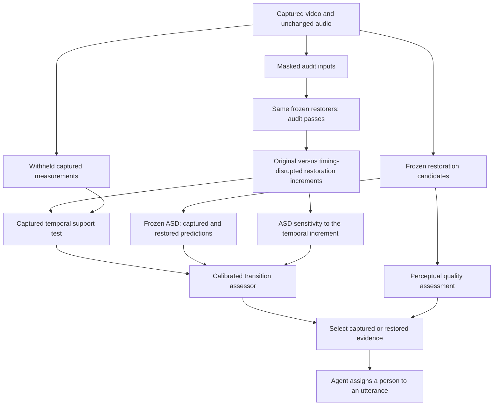

# Proposed method: Captured Temporal Support for restoration assessment

**Status: research proposal, not an implemented or validated method.** Repository head reviewed: `08d9ff2a21e88a38da379e1193a75c228a4dff44`. Literature checked on 15 October 2026. This document preserves the current RQs: quality-assessor agreement, assessment of speaker-evidence preservation, and useful restoration selection. It does not restart the completed initial pilot or claim that its failed screens passed.

**Recommendation:** build one task-aware audiovisual quality assessor around a test of the temporal evidence added by restoration. Use agents to evaluate its downstream usefulness. Do not make a collection of agents or a combination of quality, confidence, and synchrony scores the claimed methodological contribution.

Working name: **Captured Temporal Support (CTS)**. This is a descriptive project name, not a novelty claim or a checked unique acronym.

## 1. The question the method must answer

A restorer changes the apparent motion of a person's mouth. An ASD model then changes its answer. That change can repair a mistake, introduce a mistake, or leave the final answer unchanged while changing its score. The current disagreement guard cannot distinguish these possibilities and blocks useful corrections.

The proposed assessment asks:

> Does the specific temporal change introduced by restoration predict original captured measurements that were withheld from the restoration audit pass, better than the same change with its timing disrupted?

This is a proposed observable test of support for a temporal change. It is not a test that determines physical truth from pixels with certainty. It does not assume the original classifier's answer is correct. It also does not count audio used to produce a restoration as independent confirmation of that restoration.

The existing learned-model pilot motivates this target: restoration sometimes harms and sometimes corrects TalkNet; quality selection can improve the average; the fixed guard can make it worse. Yesterday's real-video Qwen runner has no newly wrong person assignments in its saved log. Its synthetic-media counterparts cannot establish natural learned-restoration hallucinations. See [the repository audit](REPOSITORY_EVIDENCE_AUDIT_2026-10-15.md).

## 2. Prior art and the precise novelty boundary

| Existing work | What is already covered | Required distinction for this proposal |
|---|---|---|
| [CDI](https://arxiv.org/html/2501.14264) | Restoration fidelity relative to degraded observations, including a reference-agnostic formulation | An ordinary consistency/re-degradation score is a baseline. CTS tests the timing of the restoration increment on withheld observations. |
| [Hallucination Score](https://arxiv.org/html/2507.14367v2), [HalluGen/SHAFE](https://arxiv.org/html/2512.03345) | Hallucination assessment, semantic fidelity, synthetic hallucination benchmarks and detectors | Do not claim to invent hallucination detection. SHAFE is full-reference; distinguish it from HalluGen's reference-free detector. |
| [THQA](https://arxiv.org/abs/2404.09003), [THEval](https://arxiv.org/abs/2511.04520) | Talking-head quality evaluation, including temporal and audiovisual dimensions | Quality plus lip synchrony is not the contribution. Our outcome is preservation of captured speaking activity under restoration. |
| [OmniHalluc-L / MPRC](https://arxiv.org/html/2606.03614) | Counterfactual event-binding evaluation and calibration using audio perturbation response shifts | Audio perturbations plus a calibration layer would overlap directly. CTS scores withheld visual measurements and the restoration increment, not just an Omni model's response to altered audio. |
| [CaRe](https://arxiv.org/abs/2610.18141) | Modality-specific counterfactual probes and residual intervention in Omni-model representations | Correcting modality conflict is not new. CTS does not modify LLM hidden states. |
| [Noise2Self](https://proceedings.mlr.press/v97/batson19a/batson19a.pdf), [Noise2Same](https://proceedings.neurips.cc/paper/2020/hash/ea6b2efbdd4255a9f1b3bbc6399b58f4-Abstract.html) | Self-supervised denoising risk and invariance-based assessment/training | Withholding pixels and the noise-cancellation identity are established. The proposed contribution must be the decision-relevant temporal contrast, with evidence beyond ordinary held-out MSE. |
| [BUQO with learned inpainting](https://arxiv.org/abs/2304.11200), [classification uncertainty under corrupted observations](https://epubs.siam.org/doi/abs/10.1137/25M1726546) | Testing reconstructed structures and propagating inverse-problem uncertainty to decisions | Merely searching for another plausible reconstruction or estimating posterior uncertainty is not novel. |
| [Q-Agent](https://arxiv.org/abs/2504.07148), [4KAgent](https://arxiv.org/abs/2507.07105), [FDIR](https://arxiv.org/abs/2608.00111) | Quality-driven restoration agents and fidelity/perception/task tradeoffs | Agent orchestration and optimizing several objectives are supporting machinery. |

The reviewed work does not establish this exact CTS procedure. That is a bounded finding, not proof of priority or absence of overlap. The proposed scientific advance is a new target for assessment: **the captured support of the restoration-induced temporal evidence that changes a speaker decision**. It must contribute useful information beyond the closest methods. A new acronym, adding mouth crops to Noise2Self, or a larger feature-fusion network would not establish that advance.

## 3. Architecture and ownership of each stage

| Stage | Component | Status |
|---|---|---|
| 1 | Capture alignment, source tracking, actual restorers and ASD backbones | Reused infrastructure |
| 2 | Masked audit passes and isolation of the restoration increment | Established mechanisms adapted to the task |
| 3 | Paired withheld-measurement test of the increment's temporal support and decision influence | Proposed methodological core |
| 4 | Four-state transition prediction and calibration | Standard learned estimation; not independently claimed as novel |
| 5 | Quality-aware selection with harm and benefit estimates | Decision rule supported by the new assessor |
| 6 | Tool integration and evaluation across agent models | Application and generalization evidence |

## 4. Stage 1 — preserve the evidence and produce candidates

Inputs are captured video Y, original audio A, stable person tracks, and a target time interval. Each restorer F_j produces a candidate X_j. Captured video is candidate zero. Use genuine checkpoints and task-matched degradations. Store the exact source, timestamps, processing, model hash, and parent capture for every candidate.

Use FastDVDnet and NLM first because the measured pilot supplies both harm and correction cases. Extend to RealBasicVSR and CodeFormer with their appropriate degradation tasks. Use TalkNet during development and an unseen detector such as Light-ASD for transfer. The assessor must be evaluated independently of which detector supplied its training labels.

Define the measurement model as Y = H_theta(X) + epsilon. Begin with identity or known linear downsampling/blur and an explicit additive-noise model. Native floating-point controlled data avoid silently treating clipped, quantized observations as unbiased Gaussian measurements. Real compressed captures are an empirical extension: the independence assumptions below do not automatically hold there.

## 5. Stage 2 — create honest audit inputs

Choose spatial measurement subsets J_k before examining the candidate outcomes. In each fold, exclude Y[J_k] from the entire audit pass. Replace those values using only retained measurements; the fill operator P_k must not read excluded values. Mask all color channels of a selected measurement site together.

Compute an audit candidate X_j^-k = F_j(P_k(Y), A). Audio is optional for the restorer, and stays identical across paired probes. It does not enter the withheld visual residual as a second independent witness.

Alignment, crop selection, interpolation, degradation fitting, normalization and temporal motion estimation must also exclude the held-out values if the theoretical argument is invoked. In a controlled study, fixed externally supplied boxes and known H are acceptable. Full-input optical flow used to warp the hidden pixels would break the exclusion condition.

A proposed initial audit uses two fixed 10% masks, selected without outcomes, with a prespecified denser-mask sensitivity check. This is a computational starting point, not an optimized or validated setting. All baseline audit methods get the same masks and restoration calls.

The full candidate X_j and masked audit candidates are different outputs. **The proposed score predicts the reliability of X_j; it does not certify X_j merely because its masked versions pass.** Measure full-versus-masked prediction stability and explicitly calibrate this transfer. If masking changes the restoration behavior too much, report that failure. Do not silently replace the deployment target with an easier masked output.

## 6. Stage 3 — assess the restoration increment

Let B^-k be a fixed lifting/interpolation baseline formed only from P_k(Y). For each audit restoration, define the increment delta_jk = X_j^-k - B^-k. Work in rigidly aligned face coordinates, using registration estimated from allowed input only.

Separate the increment into its temporal mean and time-varying part within each person's mouth region. Keep the rest of the image and static appearance fixed. Construct timing-disrupted alternatives by shifting or permuting only that time-varying mouth increment. Use multiple prespecified shifts, avoid boundary artifacts, and preserve its scale. These alternatives are diagnostic probes, not labelled real examples or evidence that a human did not speak.

For each fixed probe, forward-project both factual and timing-disrupted candidates into the capture domain. On held-out mouth measurements, calculate

\[
S_{jkp}=\frac{1}{L}\sum_{l=1}^{L}
\left[\ell_{J_k,p}(Y,H_\theta X^{\pi_l}_{jk})
-\ell_{J_k,p}(Y,H_\theta X^{-k}_{j})\right],
\]

where ell is mean squared prediction error over the same excluded measurement sites. Per-person/time weights, if used, must be fixed or depend only on allowed measurements. Positive S means the proposed timing explains the excluded observations better than the timing-disrupted alternatives. Zero does not prove falsity; the capture may not resolve the difference.

Also measure how much the same probes change a frozen ASD model's per-person speaking logits with audio fixed. Retain the signed effect, rather than treating any difference as harm. A useful correction might remove a spurious speaking cue, so both increases and decreases matter.

The resulting assessment has two interpretable axes:

- Is the added temporal structure supported by withheld capture measurements?
- Does that structure materially influence the speaker decision?

High decision influence with weak captured support is the hypothesized risk pattern. It is not an automatic hallucination label: the downstream model may already be wrong, or the raw observations may be too weak. The next stage learns the actual harm/correction relationship on separate labelled development data.

Required controls include cheek-region probes, rigid head-motion controls, static enhancement, full-frame temporal probes, mouth-only held-out MSE, and timing-preserving interventions of comparable magnitude. Otherwise the score might detect generic motion, masking artifacts, or noise removal rather than speaker-relevant restoration effects. Check correlation with raw SNR and mouth size and compare within those strata.

### What the mathematics does and does not establish

For a hidden measurement Y_J = Z_J + epsilon_J with conditionally mean-zero noise, suppose factual and control predictions u and v cannot access epsilon_J. Then

\[
\mathbb E[\|Y_J-v\|^2-\|Y_J-u\|^2]
=\mathbb E[\|Z_J-v\|^2-\|Z_J-u\|^2].
\]

The shared noise term cancels. This is an application of established self-supervised risk reasoning, not our new theorem. It concerns prediction error in the measurement domain. It does not prove speaking identity, yield an individual-example confidence certificate, justify selecting masks using test outcomes, or survive correlated/biasing noise without additional analysis.

Lost details can remain fundamentally unidentifiable. If factual and opposing temporal structures produce indistinguishable observations, this test must remain uninformative. A quality improvement cannot supply evidence missing from the capture.

## 7. Stage 4 — estimate harm and correction separately

Freeze restoration and ASD backbones. Train a compact temporal head from per-person CTS values, signed ASD influence, full-versus-audit stability, captured/restored logits, and visibility/degradation indicators. A concrete starting architecture is two 1D temporal convolution layers of width 64 and kernel size 3, masked temporal pooling, and a four-class softmax head. Compare it with logistic regression and a small tree model using identical features and labels; architectural complexity is not the novelty.

Use verified ground truth to label each captured/candidate pair as CC, CI, IC, or II, where C/I mean correct/incorrect for the specified detector and scoring unit. Train with four-class cross-entropy; if balancing or oversampling is used, recalibrate to the evaluation prevalence on an independent calibration split. The outputs include

\[
\hat h_j=P(CI\mid\text{audit}),\qquad
\hat g_j=P(IC\mid\text{audit}).
\]

These are estimates of detector transitions, not probabilities that a particular pixel is invented. Train on multiple source-disjoint labelled videos, not the eight pilot cases. All pilot sources are development-only. Paired degradation variants, neighboring windows and camera views of the same event stay together.

Human review and reference-supported temporal diagnostics form an independent evaluation of evidence preservation. They are needed if the paper claims more than predicting a detector's behavior. A detector-trained assessor's effect on final agent answers is measured separately; do not relabel frame harm probabilities as calibrated agent-error probabilities.

## 8. Stage 5 — select useful evidence

At full coverage, select a candidate with the highest prespecified perceptual quality among those meeting calibrated constraints on estimated introduced errors and expected net correction. Candidate zero is captured and has zero relative transition harm/gain by definition; this does not mean its predictions are correct.

A starting development policy is

\[
j^*=\arg\max_j Q_j\quad
\text{subject to }\hat h_j\leq\tau_h,
\quad\hat g_j-\hat h_j\geq-\tau_{net}.
\]

Thresholds are chosen on calibration data, then fixed. Report a sweep of harm/correction/quality tradeoffs instead of one hand-picked threshold. This is an estimated-risk policy, not a distribution-free safety guarantee. Human quality judgments remain necessary to establish perceptual gains; the selecting quality metric cannot independently validate itself.

This allows the method to accept a changed answer when the added evidence is supported and to reject a visually attractive but unsupported change. Its intended advantage over disagreement is preserving corrections while limiting new errors. Whether it achieves that is the experiment.

## 9. Stage 6 — expose the assessor to agents

Provide a typed tool output with candidate ID, parent capture/time/person IDs, quality change, estimated harm/correction, evidence-support diagnostics, and the recommended evidence. Compute all numeric summaries in code; do not ask an LLM to recount frame probabilities.

Use the same frozen assessor and tool schema for GPT-, Claude-, Gemini-, Qwen-, Llama-, and GPT-OSS-based controllers where access and tool compatibility are verified. Pin exact serving versions. These are tool-mediated agents; direct audio/video models are a separate experiment. Keep prompts, tools, available information and execution budgets matched within each comparison.

Compare deterministic selection alone, an agent without the assessor, an agent with the same budget of existing baseline tools, and an agent with CTS. Include a prompt-warning-only baseline. Track disagreement between the selector recommendation and the agent's final person assignment. If the controller adds no benefit over deterministic selection, report that instead of assigning it methodological novelty.

Use AMI and EasyCom for person–utterance evaluation after verified mapping; use AVA for labelled ASD and source-disjoint development. Do not call AVA activity labels verified utterance-to-person transcripts. The research remains audiovisual quality assessment, with agent decisions as the application endpoint.

## 10. Decisive experiments and falsification

| Claim | Decisive comparison | What would defeat the claim |
|---|---|---|
| CTS supplies a new assessment signal | Ordinary held-out MSE; mouth-only MSE; CDI; synchrony; confidence; disagreement; equally trained fusion; applicable MPRC-style probes | CTS adds no information beyond those controls on new sources |
| Signal concerns restoration-induced temporal evidence | Remove masking; remove temporal contrast; replace mouth with cheek; preserve timing while matching perturbation magnitude; control for SNR/visibility | Benefits arise only from generic sharpness/noise, a mask artifact, or another scalar confidence proxy |
| Harm and correction are distinguished | Same-disagreement harmful and beneficial pairs, evaluated at their real prevalence | Method rejects both equally and gains only through retaining almost everything |
| Selector is useful | Captured; best fixed restorer; quality selector; existing safeguard; same-compute fusion | Fewer harms are purchased entirely by eliminating corrections/quality gain |
| Method transfers | Unseen source, restorer and detector; calibration frozen | Only the training restorer/detector benefits |
| Agent benefit is real | Verified person–utterance labels; identical evidence budget across controllers | Improvement exists only in frame ASD, not final attribution, or depends on extra privileged information |

Metrics retain the four-table plan: full-coverage attribution accuracy, new errors H, corrections G, human quality preference and video-quality change; harm AP and calibration; assessor-agreement strata; component ablations. Report source-clustered paired confidence intervals. For abstention, report matched coverage separately. No all-positive outcome is assumed.

The first build is **method development**, not a repeat of the original hypothesis pilot: add masked audit calls, temporal controls, saved diagnostic scores, then train/calibrate the small head on new labelled development sources. Keep the final source/restorer/detector tests locked. Do not expand to every agent family until the new score is competitive with the closest assessment baselines.

## 11. Scope limits that affect implementation

- Compressed video, demosaicing, resizing and temporal codecs can correlate noise. Holding out decoded pixels alone does not make their noise independent. The exact argument begins with controlled independent-noise data; block masks and real-capture results are empirical sensitivity tests unless a valid noise model is established.
- Temporal permutations can introduce artifacts. Match intervention strength, preserve appearance, and include non-mouth controls. Probe failure is not a ground-truth negative label.
- A restorer may be sensitive to missing pixels. Audit-to-full transfer is a required measured result, not a hidden assumption.
- Some speakers have little visible articulation or are occluded. Weak CTS is uncertainty, not evidence that the person is silent.
- Shared model errors can make both captured and restored predictions wrong. The four-state target includes II; agreement is never treated as correctness.
- The core method needs original captures and access to rerun a restorer with masked inputs. A service providing only final enhanced video cannot support this procedure as specified.
- No new huge foundation model, multi-agent debate, or audio-conditioned generator is required for the first implementation. Actual restoration computation remains necessary; runtime must include audit passes.

## 12. Claim to pursue

Proposed contribution, conditional on successful experiments:

> An audiovisual restoration assessor that tests whether the restoration-induced temporal changes influencing speaker predictions are supported by withheld captured measurements, and uses that assessment to retain useful quality gains while reducing newly introduced speaker errors.

The method is narrow enough to build and falsify, and places quality assessment at the center of the paper. Its novelty rests on the temporal evidence test and demonstrated incremental value. The scaffold uses established restoration, self-supervised risk, calibration and selection components, which must be credited. Current evidence supports developing this proposal; it does not establish priority, positive final results, or conference acceptance.
