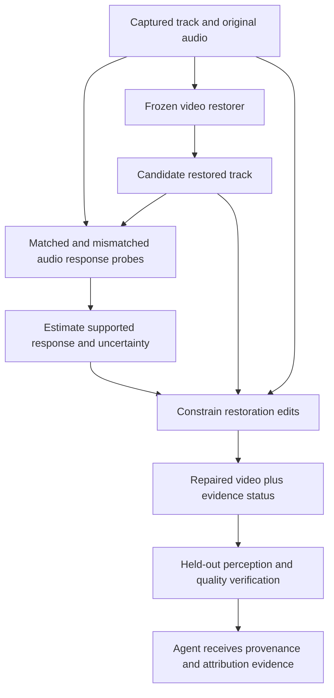

# Proposed solution: repair restoration changes that disrupt audiovisual evidence

Status: a concrete research proposal informed by executed exploratory tests. Not a validated framework, exhaustive novelty claim, or promise of reviewer acceptance. The experiment results are in `TEMPORAL_SOLUTION_SCREEN_2026-10-16.md`; prior-work boundaries are in `NOVELTY_BOUNDARIES_2026-10-16.md`.

Completed result: none of the three simple prototypes passed the frozen solution screen. Captured and static-residual inputs both have 236/633 errors; the static prototype corrects two captured errors and introduces two others, and retains only +0.019 mean MUSIQ versus full restoration's +4.003. Dynamic residual has 272 errors, half blending 257, and full restoration 269. The timing-response diagnostic has descriptive harm AUROC 0.750 versus disagreement's 1.000 on this limited candidate set. Thus this document is a candidate design to investigate, not a selected winning method. The tested shortcut of preserving global pixel differences is insufficient.

## One central idea

**Constrain what restoration is allowed to change about the relationship between a visible person's motion and the soundtrack, while retaining changes that improve appearance.**

An ordinary quality score measures the result's appearance. A speaker-confidence score measures one model answer. Neither tells us whether restoration altered the evidence connecting the visible person to the audio. The proposed assessor examines that *change in relationship*. A repair stage would then modify the restoration itself instead of choosing only between the two entire videos.

This is the candidate contribution to investigate. Combining existing tools is acceptable when attributed, but the contribution cannot be the tools' mere combination. It would have to be a new, useful and independently validated evidence-preservation objective and repair algorithm.

## Architecture and experimental status

| Stage | Purpose | What exists now |
|---|---|---|
| Captured/restored comparison | Preserve exact input and soundtrack provenance | Executed, hashed, baseline scores reproduced |
| Audio-timing probes | Measure whether restoration changes matched-versus-mismatched response | Executed on 17 pairs with original audio and two circular shifts; diagnostic only |
| Edit decomposition | Separate changes constant in time from changes varying across frames | Three simple fixed prototypes executed; no learned decomposition |
| Uncertainty-aware constraint | Avoid treating a weak or wrong captured response as truth | Proposed, not fitted or validated |
| Selective repair | Retain appearance benefits while controlling evidence changes | Proposed; current whole-frame prototypes are controls, not this solver |
| Independent validation and agent handoff | Detect detector-specific optimization and trace downstream errors | Existing agent traces audited; no Qwen calls on the new repaired candidates |

## The quantity we would preserve

Let `x` be the captured track, `y` its restored candidate, `a` the original audio, and `D` a fixed audiovisual perception model. For an audio timing intervention `delta`, define:

`S(v, delta) = D(v, a) - D(v, shifted(a, delta))`.

The current experiment measures the change in this response contrast:

`E(x, y) = mean over time of abs(S(y) - S(x))`.

This is only a diagnostic. It is not calibrated risk, a ground-truth synchronization score, or a new validated metric. Two short circular shifts are particularly limited: they introduce wrap boundaries and may not destroy correspondence in repetitive speech. Longer natural-context offsets and speaker-identity mismatches must replace or complement them in a serious method evaluation.

The research formulation is to seek a partially repaired video `z` that retains candidate quality while keeping supported audiovisual response changes within an independently calibrated budget. Unlike forcing `D(z,a)=D(x,a)`, a relational constraint could in principle allow useful confidence or appearance changes. Whether that distinction is useful is unproved.

There are two major failure cases we must explicitly address:

1. **The captured response is wrong or uninformative.** Preserving it can preserve errors. A stable response is not necessarily correct. A development-set calibration and a declared insufficient-evidence outcome are necessary; no theoretical correctness certificate is currently available.
2. **Both matched and mismatched responses change equally.** The contrast can remain unchanged while the final answer becomes wrong. The common response component and ordinary prediction-change baselines must be tested alongside the contrast. A contrast-only safeguard is not sufficient by construction.

## What the executed prototypes test

Write the restoration residual as `e_t = y_t - x_t`.

- **Static correction:** `z_t = x_t + mean_t(e_t)`. Before clipping/rounding, frame differences equal those of `x`. This tests whether retaining captured temporal variation can recover attribution. It also retains noise and can lose restoration quality.
- **Dynamic correction:** `z_t = x_t + e_t - mean_t(e_t)`. Before clipping/rounding, frame differences equal those of `y`. This is the complementary intervention.
- **Half blend:** `z_t = 0.5*x_t + 0.5*y_t`. This checks whether a trivial interpolation already provides the same benefit.

These are deliberately ordinary controls, not novelty claims. Without motion alignment, temporal averaging mixes head movement, illumination and texture; it does not isolate anatomical lip motion. Their purpose is to test the proposed explanation and establish simple baselines before training a more complex repair.

## What would make this a defensible method contribution

The future solver must show all of the following, on sources not used to design it:

- It repairs some errors beyond always retaining the captured input, or preserves the same attribution accuracy with a measured and meaningful perceptual improvement. These are separate claims with separate non-inferiority or improvement analyses.
- It improves on ordinary blending, temporal smoothing, confidence/disagreement gating and a faithful task-utility controller—not merely on always-restored.
- The proposed relational constraint adds value beyond a direct synchronization score, a raw prediction-preservation constraint and a generic temporal-consistency penalty.
- Benefits remain when a second, unoptimized perception model evaluates the repaired video, and when a second agent consumes its tool outputs.
- Error reductions do not come solely from answering fewer timestamps. Report matched-coverage risk and all abstentions.
- Clip/source-level uncertainty, quality distributions, failure examples, and operational cost are disclosed. Averages must not hide sources made worse.

If these conditions fail, do not turn the current prototype into a named framework. An honest empirical finding can still be valuable; an unsupported method claim would weaken it.

## Why others might use the work

A useful release would accept captured video, candidate restoration, original audio, and a perception-model adapter; return per-interval evidence changes, repaired candidates where justified, and an explicit evidence status. Its main value would be a reproducible evaluation protocol and interchangeable adapters, rather than a diagram with many modules. Wide adoption is an outcome to earn through utility, documentation and reproducibility—not something the current evidence can promise.

The independent 12-source queue remains untouched. Do not tune this proposal on those sources and later call them held-out confirmation.
