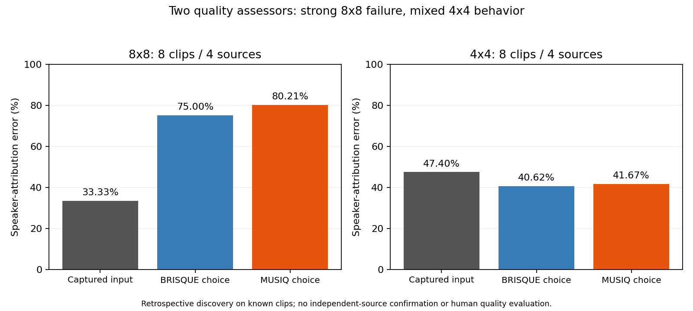

# WVAQ failure discovery and research-question selection

**Decision: YES to planning independent validation of metric-consensus failures.** Novelty and full-paper readiness are not established.

## Concrete motivation

An enhancement service, restoration benchmark, or agent may use several quality assessors to choose an output. Agreement can look reassuring. But agreement about output appearance does not logically establish preservation of the captured event. The WVAQ research target is when assessor agreement can or cannot support restoration selection, and how quality assessment should communicate that limit.

## What this additional pilot tested

- Eight previously examined UniTalk clips, four source videos, two degradation levels, all retained. This is retrospective failure discovery; no independent holdout was introduced.
- Native 8x8 was deliberately chosen as the primary stratum because the prior BRISQUE failure was strongest there. Effective 4x4 remains a reported counterexample stratum. This is an explicit follow-up hypothesis, not a rescue or replacement of the previously failed cross-resolution gate.
- Protocol fixed in `90e11cc` before MUSIQ inference. Compare BRISQUE LIVE-R2 with the PyIQA implementation of MUSIQ KonIQ10k, using exactly the same five frames (0, 6, 12, 18, 24) per candidate. Both select whole clips without labels or references.
- Candidate menu: degraded input, Ear visual-only restoration, original-audio Ear restoration, and unsharp amount 1. Existing full-clip TalkNet scores and author labels are reused with pixel/hash checks. No new restoration or speaker inference is claimed.
- **321 new MUSIQ CPU evaluations**, including an exact identical-input repeat. BRISQUE scores are reused at the matched sampled indices; these selections may differ from the earlier 25-frame averages.
- Screening requires MUSIQ-selected error at native 8x8 to exceed degraded-only error by at least 10 percentage points in the pooled sample, with source-level harm in at least three sources. The consensus screen additionally requires at least three agreed non-input choices and agreed harmful choices in at least two sources.

## Measured errors and agreement

| Input size | Degraded-only error | BRISQUE selection | MUSIQ selection | Metrics agree | Agreed harmful cases |
|---|---:|---:|---:|---:|---:|
| 8 | 33.33% | 75.00% | 80.21% | 5/8 | 5/5 |
| 4 | 47.40% | 40.62% | 41.67% | 2/8 | 1/2 |



An agreed harmful case means both assessors choose the same candidate and its measured speaker error is higher than the degraded input on that same clip. It does not mean every frame is wrong or the output is judged perceptually poor by humans. This is agreement on a relative winner, not calibrated assessor confidence or evidence of high absolute perceptual quality. A minimum-quality rejection rule is an important additional baseline for independent validation.

| Input size | Error on agreed selections | Degraded error on exactly those cases | Harmed sources among agreements |
|---|---:|---:|---|
| 8 | 69.17% | 12.50% | Pc5iQdNpDX0, QRXbRSq8p4s, lnAa1N5ynyI |
| 4 | 45.83% | 58.33% | Pc5iQdNpDX0 |

| Fixed screen component | Result |
|---|---|
| musiq_error_increase | PASS |
| musiq_sources | PASS |
| consensus_noninput | PASS |
| consensus_harm_sources | PASS |

| Case | BRISQUE choice | MUSIQ choice | Degraded error | MUSIQ-selected error |
|---|---|---|---:|---:|
| lnAa1N5ynyI__label0__r8 | visual_only | visual_only | 0.00% | 100.00% |
| lnAa1N5ynyI__label0__r4 | matching | degraded | 0.00% | 0.00% |
| lnAa1N5ynyI__label1__r8 | visual_only | visual_only | 41.67% | 45.83% |
| lnAa1N5ynyI__label1__r4 | matching | degraded | 41.67% | 41.67% |
| Pc5iQdNpDX0__label0__r8 | visual_only | visual_only | 0.00% | 25.00% |
| Pc5iQdNpDX0__label0__r4 | visual_only | degraded | 4.17% | 4.17% |
| Pc5iQdNpDX0__label1__r8 | matching | matching | 20.83% | 83.33% |
| Pc5iQdNpDX0__label1__r4 | visual_only | visual_only | 75.00% | 91.67% |
| QRXbRSq8p4s__label0__r8 | visual_only | visual_only | 0.00% | 91.67% |
| QRXbRSq8p4s__label0__r4 | visual_only | visual_only | 41.67% | 0.00% |
| QRXbRSq8p4s__label1__r8 | visual_only | matching | 100.00% | 100.00% |
| QRXbRSq8p4s__label1__r4 | matching | unsharp_1 | 100.00% | 95.83% |
| ho_oK12hY6M__label0__r8 | matching | visual_only | 4.17% | 95.83% |
| ho_oK12hY6M__label0__r4 | matching | visual_only | 20.83% | 0.00% |
| ho_oK12hY6M__label1__r8 | matching | visual_only | 100.00% | 100.00% |
| ho_oK12hY6M__label1__r4 | visual_only | matching | 95.83% | 100.00% |

## Closest work: claims we cannot call novel

| Prior work | Already addresses | Consequence for our proposal |
|---|---|---|
| [LL-Bench](https://arxiv.org/abs/2606.02535) | Human restoration preferences, over-processing labels, and an evaluator covering quality/hallucination | “Quality and fidelity differ” is not a new contribution. |
| [CDI](https://arxiv.org/abs/2501.14264) | Fidelity assessment through consistency with degraded input | A simple re-degradation-consistency score is a baseline, not our claimed invention. |
| [FGResQ](https://sxfly99.github.io/FGResQ-Home/) | Fine-grained restoration quality assessment | “Fine-grained IQA for restoration” is already an established direction. |
| [QualiTeacher](https://arxiv.org/abs/2603.08030) | Uses an NR-IQA ensemble for pseudo-label quality and a consistency loss to limit reward hacking | Both assessor ensembles and IQA over-optimization are existing topics; this paper motivates practical relevance but must be compared closely. We did not evaluate its system. |
| [DISRQAD](https://arxiv.org/abs/2610.09077) | Perceived-quality benchmarking across diffusion and non-diffusion SR; explicitly distinguishes perceived quality from input faithfulness | A generic diffusion-IQA benchmark would overlap strongly. Our pilot uses no diffusion model. |

This is a bounded literature review, including abstracts and official project descriptions, not an exhaustive priority determination. No claim of “first”, high novelty, or guaranteed acceptance is supported.

## Best-supported candidate questions

1. **Reliability of assessor agreement:** Under which degradation and restoration conditions does agreement among image-quality assessors fail to indicate preservation of task-relevant captured information?
2. **Input-conditioned assessment:** Can an assessor estimate the risk of shared quality-metric errors from the degraded input and candidate outputs, beyond metric disagreement, prediction confidence, and existing input-consistency baselines?
3. **Useful quality selection:** Can combining perceptual quality with that estimated fidelity risk select outputs that improve task performance over always using the captured input, while preserving perceptual quality on unseen sources and restoration families?

RQ1 has pilot evidence only if the stated screens pass. RQ2 and RQ3 are proposed research questions; no new risk estimator, cross-model validation, or successful quality-preserving safeguard was tested here. The potential contribution would be diagnosing and calibrating the reliability of quality-assessor agreement for selection. Merely adding two metrics or demonstrating another bad restoration is insufficient.

## What a justified research plan must resolve

- Keep discovery examples separate from new-source validation. Freeze source selection, candidate menu, comparison methods, and outcomes before examining validation results.
- Use restoration models appropriate for the task and additional learned/VLM quality assessors; demonstrate useful restoration corrections as well as errors. The framewise Ear model remains an unsuitable-temporal-model alternative explanation.
- Measure human perceptual quality separately from labeled task errors. A quality model may correctly judge appearance while being misused as an evidence-reliability measure.
- Compare quality-only, assessor agreement, task confidence, existing consistency methods, and always-captured-input baselines at the same coverage. RQ3 must beat the captured-input baseline, not merely a weak quality selector.
- Evaluate source-level uncertainty and transfer to an unseen restoration family. Only call the resulting method novel after close comparison with the nearest published approaches.

A large number of failures establishes neither novelty nor practical value. The usefulness test is whether the assessment enables better choices than simply refusing restoration. The current pilot cannot settle that test.

## Reproduce and artifacts

```powershell
python -m pip install --target tools/iqa_models --no-deps pyiqa==0.1.14.1
python scripts/wvaq_consensus_pilot.py
python scripts/audit_wvaq_consensus.py
python scripts/report_wvaq_consensus.py
```

Requires existing PyTorch/scientific dependencies and the completed WVAQ quality-selection outputs. The released MUSIQ checkpoint is downloaded publicly by PyIQA; its SHA-256 and implementation hashes are recorded. All inference is CPU. Model defaults process native-resolution RGB tensors. Raw media and weights remain local.

Saved evidence: `wvaq_consensus_protocol.json`, `results/wvaq_consensus_pilot.json`, `results/wvaq_consensus_audit.json`. Related previous decision: `WVAQ_INITIAL_HYPOTHESIS.md` (unchanged).
