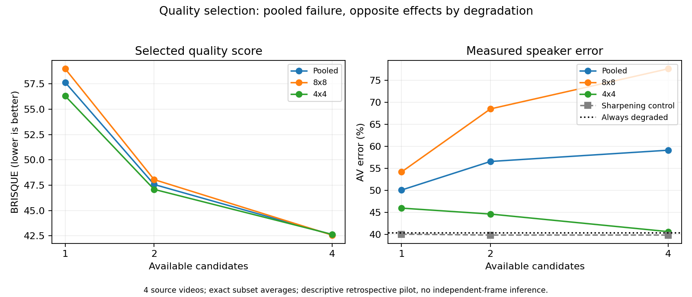

# WVAQ initial hypothesis: selecting enhancement by blind quality

**Decision: REJECT advancing this tested failure hypothesis.** Full-paper readiness is not established.

## Motivation and hypothesis

An enhancement tool can generate several candidates and retain the one receiving the best image-quality score. A quality assessor then becomes a decision objective, not just a descriptive score. The scientific issue is whether improving that objective also preserves task-relevant evidence. An agent that chooses an enhancement is one application; this study evaluates the selection operation, not an end-to-end agent.

**Fixed hypothesis:** increasing the number of available enhancement candidates improves selected blind-IQA score while increasing active-speaker error. A score improvement by itself is guaranteed by best-score selection and is not evidence of a failure; increased labeled error is the substantive endpoint.

## Design fixed before new IQA measurements

- Protocol committed in `e9c1592`, before computing BRISQUE selections. Previous restoration and speaker results on these clips were already known: this is retrospective exploration, not an untouched holdout.
- All eight previously selected UniTalk clips from four sources, at native 8x8 and effective 4x4 degradation, are retained. Published speaking labels are benchmark ground truth, not new human annotations.
- Primary pool: degraded input, official Ear visual-only restoration, original-audio Ear restoration, and mild unsharp masking (amount 1). No misleading donor-audio candidate enters this pool.
- Conventional control: degraded input and unsharp masking amounts 0.5, 1 and 2, with Gaussian sigma 1. Duplicate control: four copies of degraded input.
- Official OpenCV BRISQUE LIVE-R2 model ranks candidates by mean score over 25 frames, lower being better. RGB is converted to BGR. No reference, speaker labels, or audio are available to this selector.
- Budgets 1, 2 and 4 use exact enumeration of uniformly sampled candidate subsets. The selector chooses a complete video clip, not individual frames. Every clip is retained (100% coverage). Budget 1 is exactly uniform-random candidate selection.
- TalkNet AV error is evaluated on the same 24 aligned frames, using unchanged original audio. V-head error, SSIM, PSNR, Brier score and uncalibrated confidence are secondary outcomes.
- New computation: 48 conventional-candidate TalkNet inferences and 2,400 BRISQUE frame evaluations. Earlier restoration outputs and their downstream scores are reused after provenance checks. No new neural restoration or GPU execution is claimed.

The screening gate requires at least 5 percentage points more AV error at budget 4 versus budget 1, at least 1 point lower mean BRISQUE, an error increase in at least three sources, and an increase at both resolutions. These are feasibility thresholds, not significance tests or publication criteria.

## Results

| Pool | Candidate budget | BRISQUE (lower better) | AV error | SSIM | V-head error |
|---|---:|---:|---:|---:|---:|
| primary | 1 | 57.652 | 50.07% | 0.5050 | 49.87% |
| primary | 2 | 47.570 | 56.55% | 0.4682 | 50.65% |
| primary | 4 | 42.612 | 59.11% | 0.4499 | 51.82% |
| conventional | 1 | 68.395 | 40.04% | 0.5591 | 48.83% |
| conventional | 2 | 62.945 | 39.84% | 0.5578 | 48.70% |
| conventional | 4 | 54.826 | 39.84% | 0.5560 | 48.44% |
| duplicate | 1 | 74.538 | 40.36% | 0.5606 | 48.96% |
| duplicate | 2 | 74.538 | 40.36% | 0.5606 | 48.96% |
| duplicate | 4 | 74.538 | 40.36% | 0.5606 | 48.96% |

Primary error change: **+9.05 percentage points**. BRISQUE improvement: **15.039 points**. Sources with increased error: **3/4**.



| Fixed gate | Result |
|---|---|
| error_increase_at_least_threshold | PASS |
| brisque_improvement_at_least_threshold | PASS |
| enough_sources | PASS |
| both_resolutions | FAIL |

| Source / resolution | Budget-1 AV error | Budget-4 AV error | Change (percentage points) |
|---|---:|---:|---:|
| source:Pc5iQdNpDX0 | 35.94% | 50.00% | +14.06 |
| source:QRXbRSq8p4s | 60.94% | 57.29% | -3.65 |
| source:ho_oK12hY6M | 62.24% | 68.75% | +6.51 |
| source:lnAa1N5ynyI | 41.15% | 60.42% | +19.27 |
| resolution:8 | 54.17% | 77.60% | +23.44 |
| resolution:4 | 45.96% | 40.62% | -5.34 |

| Baseline / selector | AV error | SSIM |
|---|---:|---:|
| Always degraded | 40.36% | 0.5606 |
| brisque (four candidates) | 59.11% | 0.4499 |
| confidence (four candidates) | 42.19% | 0.5098 |
| ssim_oracle (four candidates) | 40.36% | 0.5606 |
| error_oracle (four candidates) | 29.69% | 0.5331 |

The SSIM and error oracles use unavailable deployment information and are diagnostics only. The error oracle chooses one complete candidate per clip; it does not switch inputs using frame labels.

## Complete case-level choices

| Case | BRISQUE winner | Degraded AV error | Selected AV error |
|---|---|---:|---:|
| lnAa1N5ynyI__label0__r8 | visual_only | 0.00% | 100.00% |
| lnAa1N5ynyI__label0__r4 | matching | 0.00% | 0.00% |
| lnAa1N5ynyI__label1__r8 | visual_only | 41.67% | 45.83% |
| lnAa1N5ynyI__label1__r4 | matching | 41.67% | 95.83% |
| Pc5iQdNpDX0__label0__r8 | visual_only | 0.00% | 25.00% |
| Pc5iQdNpDX0__label0__r4 | visual_only | 4.17% | 0.00% |
| Pc5iQdNpDX0__label1__r8 | matching | 20.83% | 83.33% |
| Pc5iQdNpDX0__label1__r4 | visual_only | 75.00% | 91.67% |
| QRXbRSq8p4s__label0__r8 | visual_only | 0.00% | 91.67% |
| QRXbRSq8p4s__label0__r4 | visual_only | 41.67% | 0.00% |
| QRXbRSq8p4s__label1__r8 | visual_only | 100.00% | 100.00% |
| QRXbRSq8p4s__label1__r4 | matching | 100.00% | 37.50% |
| ho_oK12hY6M__label0__r8 | visual_only | 4.17% | 95.83% |
| ho_oK12hY6M__label0__r4 | matching | 20.83% | 0.00% |
| ho_oK12hY6M__label1__r8 | matching | 100.00% | 79.17% |
| ho_oK12hY6M__label1__r4 | visual_only | 95.83% | 100.00% |

## Research decision

**A quality-selection failure was observed, but the full fixed hypothesis did not pass.** At 8x8, selecting from four candidates instead of one changes error by +23.44 percentage points. At 4x4, the change is -5.34 points, contradicting the required cross-resolution pattern. The pooled increase must not hide this counterexample.

The primary pool shows worsening task performance despite improving BRISQUE, while the conventional control does not show the same pooled error increase and the duplicate control is exactly invariant. BRISQUE chooses a neural restoration in every primary-pool case. This diagnoses a concrete weakness of this assessor/candidate combination; it does not isolate a general generative-model mechanism because the candidate pools differ.

Do not launch a full paper from this experiment alone. Preserve the measured failure and its counterexample, rather than relaxing the gate, dropping 4x4, or describing this as a universal quality-versus-reliability result. The other proposed ideas about repeated-evidence certainty and hypothesis-conditioned restoration were not tested here.

## Interpretation boundaries

A positive screen establishes a BRISQUE-specific selection failure on these clips, not a failure of all IQA metrics or a novel method. A negative screen rejects promotion of this tested budget-effect claim from this pilot. Individual adverse examples do not override the gate.

BRISQUE is a classical natural-scene-statistics model trained on LIVE-R2, not a modern generative-face quality judge. Tiny upsampled face crops may be outside its intended distribution. Its score is not a human quality judgment. Independent perceptual quality is not measured. The Ear model was designed for framewise face/voice identity reconstruction, not temporal lip synchronization; the existing unsuitable-model explanation remains a serious alternative.

Only four source videos are independent groups; frames, overlapping tracks, degradation variants and candidate subsets are not independent samples. No frame-level significance test or population confidence is claimed. The pools mix tools and settings; this is budget over a fixed candidate menu, not repeated stochastic samples of one generator. No end-to-end agent, novel safeguard, unseen-model transfer, or full-paper hypothesis has been validated.

## Reproduce

```powershell
python -m pip install --target tools/quality_cpu --no-deps opencv-contrib-python-headless==4.12.0.88
python scripts/wvaq_quality_pilot.py
python scripts/audit_wvaq_quality.py
python scripts/report_wvaq_quality.py
python -m unittest discover -s tests -p test_wvaq_quality.py -v
```

Requires the local UniTalk inputs, completed Ear outputs, and official TalkNet checkpoint from FINAL_CPU_RESEARCH_DECISION.md. The IQA dependency is isolated under tools/quality_cpu. Official BRISQUE weights are downloaded unauthenticated and their hashes recorded. Media and weights are excluded from Git.

Artifacts: `wvaq_quality_protocol.json`, `results/wvaq_quality_pilot.json` (complete scores/provenance/curves), and `results/wvaq_quality_audit.json` (independent arithmetic audit).

References: [OpenCV BRISQUE model documentation](https://docs.opencv.org/4.12.0/d8/d99/classcv_1_1quality_1_1QualityBRISQUE.html), [official weights](https://github.com/opencv/opencv_contrib/tree/4.12.0/modules/quality/samples), [WVAQ scope](https://wacv2027-image-quality-workshop.github.io/).
